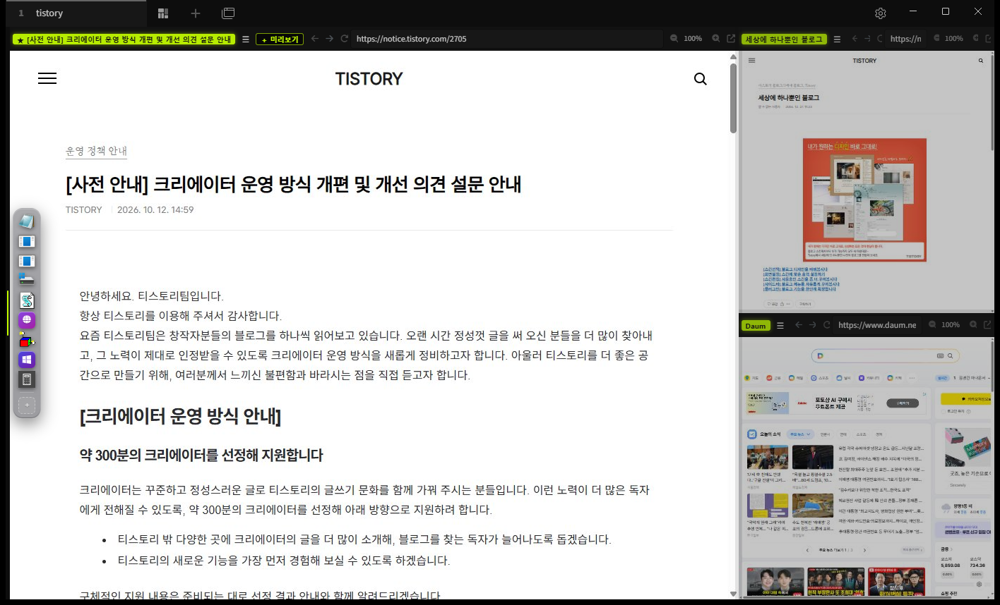

<div align="center">

# hagis by tabby

**네트워크 엔지니어를 위한 [Tabby](https://github.com/Eugeny/tabby) 통합 워크스페이스 플러그인**<br>
<sub>An all-in-one workspace plugin for [Tabby](https://github.com/Eugeny/tabby), built for network engineers</sub>

**H**ub for **A**ll **G**ear, **I**n **S**ight — *장비 전부를 한눈에*<br>
<sub>HAGIS = **H**ub for **A**ll **G**ear, **I**n **S**ight</sub>

[](LICENSE)
[](https://github.com/toffthechicken/tabby-hagis/releases/latest)


made by **JakeandToff** · Instagram [@toomuchthought.kr](https://www.instagram.com/toomuchthought.kr/)



</div>

---

## 목차 · Contents

[소개](#소개--about) · [기능](#기능--features) · [설치](#설치--installation) · [사용법](#사용법--usage) · [성능](#성능-설계--performance) · [보안](#보안과-개인정보--security--privacy) · [호환성](#호환성과-알려진-제한--compatibility--known-limits) · [개발](#개발--development) · [라이선스](#라이선스--license)

---

## 소개 · About

여러 고객사의 방화벽·스위치·서버를 오가며 일하다 보면 SSH 창, 장비 웹 관리 페이지, 메모, AI 코딩 도구가 한꺼번에 필요합니다.
hagis 는 Tabby 의 SSH·Telnet·Serial 엔진과 분할 화면을 **그대로 쓰면서**, 이런 작업을 한 화면에서 다루기 편하도록 UI 를 다시 짠 플러그인입니다.
고객사별 레이아웃을 저장해 두고 한 번에 열고, 장비 웹 GUI 를 터미널 옆 패널로 띄우고, 크게 볼 화면 하나와 작은 미리보기 여러 개로 여러 장비를 감시할 수 있습니다.

<sub>When you work across many customers' firewalls, switches and servers, you need SSH sessions, device web GUIs, notes and AI coding tools side by side.
hagis keeps Tabby's SSH / Telnet / Serial engines and split view as they are, and reshapes the UI around that workflow:
save a layout per customer and reopen it in one click, put device web GUIs next to terminals, and watch many devices with one big main pane plus small live previews.</sub>

> hagis 는 Tabby 팀과 무관한 **비공식 서드파티 플러그인**입니다. · <sub>hagis is an **unofficial third-party plugin**, not affiliated with the Tabby project.</sub>

---

## 기능 · Features

| 기능 | 설명 |
| --- | --- |
| **레이아웃 프리셋**<br><sub>Layout presets</sub> | Network Workspace, 메인 + 미리보기, 상단 1 + 하단 4, 메인 + 보조 3, 좌우 비교, 2×2 / 3×3 / 4×4<br><sub>Ready-made grids and main + preview layouts, started without pane titles.</sub> |
| **고객사별 워크스페이스**<br><sub>Per-customer workspaces</sub> | 배치·비율·프로필·글자 크기·웹 주소·태그 이름/색·작업 폴더·이어가기 명령을 고객사별로 저장하고 한 번에 엽니다.<br><sub>Save layout, ratios, profiles, font sizes, web URLs, tag names/colors, working folders and resume commands per customer; reopen in one click.</sub> |
| **메인 무대**<br><sub>Main stage</sub> | 큰 메인 패널 1개 + 보기 전용 미리보기 최대 20개. 미리보기를 클릭하면 메인과 자리를 바꿉니다(웹 로그인·스크롤·터미널 세션 유지). 미리보기가 늘어도 메인 크기는 그대로, 미리보기만 격자로 작아집니다. 웹 미리보기는 절전 캡처로 갱신되고 주소창은 그대로 입력할 수 있습니다.<br><sub>One big main pane plus up to 20 view-only previews. Click a preview to swap it with the main pane (web logins, scroll position and terminal sessions stay alive). The main pane never shrinks; previews tile into a grid. Web previews refresh from power-saving snapshots and keep a usable address bar.</sub> |
| **웹 GUI 패널**<br><sub>Web GUI pane</sub> | 분할 패널 안의 Chromium 뷰. Chrome 처럼 HTTPS 우선 → 실패 시 HTTP, 장비 인증서는 지문을 확인한 뒤 신뢰. 새 탭 링크는 같은 패널에서 열고, 403 같은 오류는 이유를 설명합니다.<br><sub>A Chromium view inside a split pane. HTTPS first, HTTP fallback (like Chrome); device certificates are trusted only after you check the fingerprint. "Open in new tab" links stay in the pane; errors such as 403 are explained.</sub> |
| **독**<br><sub>Dock</sub> | 화면 옆의 유리 질감 실행 막대 — 프로그램·폴더·Tabby 프로필·워크스페이스·웹 주소. 탐색기에서 끌어다 놓아 추가, 마우스를 올리면 아이콘 확대, 얇은 손잡이로 접기, 또는 **자동 숨기기**(가장자리에 마우스를 대면 macOS 독처럼 나옴).<br><sub>A glassmorphism launcher bar at the screen edge: apps, folders, Tabby profiles, workspaces, URLs. Drag items in from Explorer, hover to magnify, collapse with a thin handle, or switch to **auto-hide** (slides out when you touch the edge, like the macOS Dock).</sub> |
| **내용 복사 · 화면 캡처**<br><sub>Copy & capture</sub> | 터미널 보이는 화면 / 최근 100줄 / 전체(스크롤백) 복사, 텍스트 파일로 저장, 패널 화면 캡처 → 클립보드·PNG. 웹 패널은 웹 화면 그대로.<br><sub>Copy the visible screen, the last 100 lines or the whole scrollback; save as a text file; capture any pane to the clipboard or PNG (web panes capture the page itself).</sub> |
| **터미널 이어가기**<br><sub>Session resume</sub> | hagis 를 껐다 켜도(강제 종료 포함) 실행 중이던 `claude`·`agy`·`codex` 를 같은 폴더에서 이어서 자동 재실행합니다.<br><sub>After a restart (even a crash), `claude`, `agy` and `codex` that were running are relaunched in the same folder with their "continue" flags.</sub> |
| **형광 네임태그 · 패널 메뉴**<br><sub>Name tags & pane menu</sub> | 패널 좌측 상단 태그 — 드래그로 이동·자리 바꾸기·새 탭 분리, 우클릭: 이름·색상·SFTP·다시 연결·복제·최대화.<br><sub>A neon tag on every pane: drag to move/swap/detach, right-click for rename, color, SFTP, reconnect, duplicate, maximize.</sub> |
| **SFTP**<br><sub>SFTP</sub> | SSH 패널은 바로 SFTP. 로컬 터미널에서 `ssh user@host` 를 실행 중이면 같은 주소로 SFTP 패널을 옆에 자동 연결합니다.<br><sub>One click from an SSH pane; if a local terminal is running `ssh user@host`, an SFTP pane for the same host opens beside it.</sub> |
| **패널별 글자 크기**<br><sub>Per-pane font size</sub> | `A− 100% A+ │ XS S M L │ ⤢` 컨트롤. 버튼 색은 Tabby 터미널 색상 설정을 따르고, 패널 폭이 좁으면 자동으로 접힙니다.<br><sub>Per-pane `A− / A+` and presets. Button colors follow Tabby's terminal color scheme; the control folds away in narrow panes.</sub> |
| **Markdown 뷰어**<br><sub>Markdown viewer</sub> | `.md/.txt/.log` 파일 자동 새로고침, 링크·상대 이미지 지원, HTML 정화(DOMPurify).<br><sub>Auto-reloading `.md/.txt/.log` viewer with links and relative images; HTML is sanitized with DOMPurify.</sub> |
| **파일 끌어다 놓기**<br><sub>Drag & drop</sub> | 탭 바 → 새 탭, 빈 패널 → 그 자리, 실행 중인 터미널 → 확인 창. 경로 붙여넣기는 셸 종류별로 안전하게 인용합니다.<br><sub>Drop on the tab bar to open, on an empty pane to load, on a running terminal to choose "replace / paste path". Pasted paths are quoted safely per shell.</sub> |
| **모서리 크기 조절 · 컴팩트 모드**<br><sub>Corner resize & compact mode</sub> | 가로·세로 경계가 만나는 모서리를 끌어 두 방향을 동시에 조절. 컴팩트 모드는 탭 바·여백·글자를 줄입니다.<br><sub>Drag the corner where two dividers meet to resize both axes; compact mode shrinks tab bar, padding and fonts.</sub> |

---

## 설치 · Installation

### 0. 준비물 · Prerequisites

- **Windows 10 / 11** — 개발·테스트 환경입니다. <sub>Developed and tested on Windows.</sub>
- **[Tabby](https://github.com/Eugeny/tabby) 1.0.238 이상** — 아직 없다면: <sub>Tabby 1.0.238 or newer. If you don't have it yet:</sub>

  ```powershell
  winget install --id Eugeny.Tabby -e
  ```

  또는 <https://github.com/Eugeny/tabby/releases/latest> 에서 `tabby-*-setup-x64.exe` 를 받아 설치합니다. (설치 프로그램 `install.cmd` 가 Tabby 가 없으면 설치를 권해 줍니다.)<br>
  <sub>Or download `tabby-*-setup-x64.exe` from the releases page. (Our `install.cmd` offers to install Tabby for you if it is missing.)</sub>

  > ⚠️ winget 에는 이름이 같은 `TabbyML.Tabby` 도 있지만 **다른 프로그램**(AI 코드 자동완성)입니다. 반드시 `Eugeny.Tabby` 를 설치하세요.<br>
  > <sub>`TabbyML.Tabby` is a different product (AI code completion). Make sure you install `Eugeny.Tabby`.</sub>

### A. 한 줄 설치 — 깡통 PC 에서도 · One-line install — works on a bare PC

Node.js·git 이 **필요 없습니다.** Windows 10 (1803 이상) / 11 에 기본으로 들어 있는 `curl` 과 `tar` 만 씁니다. 명령 프롬프트(cmd)에 붙여 넣으세요:<br>
<sub>No Node.js or git needed — it only uses `curl` and `tar`, which ship with Windows 10 (1803+) / 11. Paste into Command Prompt (cmd):</sub>

```bat
curl.exe -L -o "%TEMP%\hagis-install.cmd" https://github.com/toffthechicken/tabby-hagis/releases/latest/download/install.cmd && "%TEMP%\hagis-install.cmd"
```

PowerShell 에서는: <sub>In PowerShell:</sub>

```powershell
curl.exe -L -o "$env:TEMP\hagis-install.cmd" https://github.com/toffthechicken/tabby-hagis/releases/latest/download/install.cmd; & "$env:TEMP\hagis-install.cmd"
```

설치 프로그램이 Tabby 가 있는지 확인하고(없으면 `winget` 설치를 권함), 최신 릴리스를 내려받아 플러그인 폴더에 복사합니다. 끝나면 **Tabby 를 완전히 종료했다가 다시 켜세요.**<br>
<sub>The installer checks for Tabby (offering `winget` if missing), downloads the latest release and copies it into the plugins folder. Then **fully quit and restart Tabby.**</sub>

> GitHub 의 **Code → Download ZIP** 은 *소스*입니다. 거기서도 `install.cmd` 를 실행하면 Node.js 가 없을 때 위와 같이 빌드된 릴리스를 대신 내려받고, 릴리스도 없으면 `winget` 으로 Node.js 설치를 권합니다.<br>
> <sub>**Code → Download ZIP** gives you the *source*. Running its `install.cmd` still works: without Node.js it fetches the prebuilt release instead, and if there is none it offers to install Node.js with `winget`.</sub>

### B. 릴리스 zip + 설치 프로그램 · Release zip + installer

직접 받아서 설치하고 싶을 때. Node.js 가 필요 없습니다. <sub>If you prefer to download it yourself. No Node.js required.</sub>

1. [Releases](https://github.com/toffthechicken/tabby-hagis/releases/latest) 에서 `hagis-<버전>.zip` 을 받습니다. <sub>Download `hagis-<version>.zip`.</sub>
2. (선택) 무결성 확인 — 같이 올라온 `.sha256` 파일과 비교합니다. <sub>(Optional) verify against the `.sha256` file:</sub>

   ```powershell
   certutil -hashfile hagis-0.1.0.zip SHA256
   ```
3. 압축을 풀고 **`install.cmd` 를 더블클릭**합니다. <sub>Unzip and **double-click `install.cmd`**.</sub>
4. **Tabby 를 완전히 종료했다가 다시 켭니다.** <sub>**Fully quit and restart Tabby.**</sub>

설치 프로그램은 서명되지 않은 일반 텍스트 배치 파일입니다. Windows 가 경고하면 "추가 정보 → 실행"을 누르세요. 실행 전에 내용을 직접 읽어볼 수 있습니다.
`%APPDATA%\tabby\plugins\node_modules\tabby-hagis` 에 파일을 복사합니다. Tabby 가 없을 때 묻는 질문에 **Y** 를 고른 경우에만 `winget` 으로 Tabby 를 설치하고, 그 외에는 아무것도 바꾸지 않습니다.<br>
<sub>The installer is an unsigned, plain-text batch file — if Windows warns you, choose "More info → Run anyway". You can read it first. It copies files into `%APPDATA%\tabby\plugins\node_modules\tabby-hagis`; only if Tabby is missing and you answer **Y** does it run `winget` to install Tabby. Nothing else is changed.</sub>

### C. Tabby 플러그인 관리자 · Tabby plugin manager

npm 에 게시된 경우: **설정 → 플러그인** 에서 `hagis` 를 검색해 설치하고 Tabby 를 재시작합니다. (업데이트도 여기서 됩니다.)<br>
<sub>If published on npm: **Settings → Plugins**, search for `hagis`, install, restart Tabby. Updates arrive the same way.</sub>

### D. 소스에서 · From source

```bash
git clone https://github.com/toffthechicken/tabby-hagis.git
cd tabby-hagis
npm ci
npm run deploy      # build + copy into Tabby's plugins folder
```

또는 `install.cmd` 를 더블클릭하면 같은 일을 합니다 (Node.js 필요). <sub>Or double-click `install.cmd` — it does the same (needs Node.js).</sub>

### 수동 설치 (Windows 외) · Manual install (other OS)

`package.json` 과 `dist/` 폴더를 Tabby 플러그인 폴더의 `node_modules/tabby-hagis/` 에 복사하고 Tabby 를 재시작합니다.
macOS·Linux 는 아직 테스트하지 못했습니다. <sub>Copy `package.json` and `dist/` into `node_modules/tabby-hagis/` inside Tabby's plugins folder, then restart. macOS and Linux are untested.</sub>

| OS | 플러그인 폴더 · Plugins folder |
| --- | --- |
| Windows | `%APPDATA%\tabby\plugins` |
| macOS | `~/Library/Application Support/tabby/plugins` |
| Linux | `~/.config/tabby/plugins` |

### 제거 · 업데이트 · Uninstall / Update

- **제거:** `uninstall.cmd` 더블클릭. 워크스페이스·설정은 Tabby 설정 파일에 남아 있어 다시 설치하면 그대로 복원됩니다.<br>
  <sub>Uninstall: double-click `uninstall.cmd`. Your workspaces and settings stay in Tabby's config and come back if you reinstall.</sub>
- **업데이트(자동):** hagis 가 GitHub 의 새 릴리스를 하루 한 번 확인해서, 있으면 물어봅니다 → **지금 업데이트** 를 누르면 SHA-256 을 확인한 뒤 플러그인 파일만 바꾸고, Tabby 를 다시 시작하면 적용됩니다. **설정 → hagis → 업데이트** 에서 "지금 확인", "물어보기 / 자동 설치 / 확인하지 않음"을 고를 수 있고, 명령 팔레트에도 `hagis: 업데이트 확인` 이 있습니다.<br>
  <sub>Update (automatic): hagis checks GitHub for a new release once a day and asks; **Update now** verifies SHA-256, replaces only the plugin files, and takes effect after restarting Tabby. Under **Settings → hagis → Updates** you can check now or choose ask / auto-install / off; the command palette has `hagis: Check for updates`.</sub>
- **업데이트(수동):** 한 줄 설치 명령이나 새 zip 의 `install.cmd` 를 다시 실행하면 덮어씁니다. <sub>Update (manual): re-run the one-line command or the newer zip's `install.cmd`; it overwrites the old files.</sub>

---

## 사용법 · Usage

| 어디서 · Where | 무엇을 · What |
| --- | --- |
| 툴바 왼쪽 **HAGIS** 버튼<br><sub>The **HAGIS** button at the left of the toolbar</sub> | hagis 런처 — 워크스페이스·프리셋·저장·컴팩트·글자 일괄<br><sub>Launcher: workspaces, presets, save, compact, font sizes</sub> |
| Tabby `＋` 버튼<br><sub>Tabby `＋` button</sub> | 프로필 목록의 `웹 GUI`, `Markdown 뷰어`<br><sub>`Web GUI` and `Markdown viewer` profiles</sub> |
| 패널 태그 우클릭 · ☰ 버튼<br><sub>Right-click a tag · ☰ button</sub> | 패널 메뉴 — 이름, 색, SFTP, 메인 무대, 내용 복사·캡처, 복제, 최대화…<br><sub>Pane menu: rename, color, SFTP, main stage, copy & capture, duplicate, maximize…</sub> |
| 명령 팔레트 `Ctrl+Shift+P` → `hagis:`<br><sub>Command palette → `hagis:`</sub> | 독 보이기/숨기기, 글자 크기 일괄, 워크스페이스 열기, 복사·캡처<br><sub>Dock toggle, bulk font size, open workspace, copy & capture</sub> |
| 설정 → hagis<br><sub>Settings → hagis</sub> | 화면 옵션, 독 설정, 이어가기 규칙, 워크스페이스 관리, 신뢰한 인증서<br><sub>Display options, dock, resume rules, workspace manager, trusted certificates</sub> |

### 메인 무대 시작하기 · Getting started with the main stage

1. 런처에서 프리셋 **메인 + 미리보기** 를 엽니다. 또는 패널 메뉴 → **메인 무대** → "이 패널을 메인으로".<br>
   <sub>Open the **Main + previews** preset from the launcher, or use pane menu → **Main stage** → "Make this the main pane".</sub>
2. 메인 패널의 **＋ 미리보기** 로 미리보기를 추가합니다 (최대 20개).<br>
   <sub>Add previews with the **＋ preview** button on the main pane (up to 20).</sub>
3. 미리보기 화면을 클릭하면 메인과 자리를 바꿉니다. 미리보기의 주소창·버튼은 그대로 쓸 수 있습니다.<br>
   <sub>Click a preview's page area to swap it into the main slot. Its address bar and buttons keep working.</sub>

### 터미널 이어가기 · Session resume

- 프로세스 자체는 앱 종료와 함께 끝납니다. hagis 는 각 CLI 의 "이전 대화 이어가기" 기능으로 다시 시작합니다.<br>
  <sub>Processes end with the app; hagis restarts them using each CLI's own "continue" feature.</sub>
- 30초마다·종료 시 각 패널에서 실행 중인 프로그램을 기록합니다 (`hagis-resume.json`, 강제 종료에도 유지).<br>
  <sub>Running programs are recorded every 30 s and on exit (`hagis-resume.json`), so it survives a crash.</sub>
- 규칙은 설정 → hagis 의 `프로세스 이름 = 명령` — 기본값: `claude = claude --continue`, `agy = agy --continue`, `codex = codex resume --last`. 패널별 명령은 태그 우클릭 → **시작 명령 지정**.<br>
  <sub>Rules are `process name = command` in Settings → hagis. Per-pane override: right-click the tag → **Set startup command**.</sub>

---

## 성능 설계 · Performance

웹 패널 7개(미리보기 6개, 포털·쇼핑·동영상 사이트)를 가만히 둔 상태의 CPU 사용량입니다 (코어 1개 = 100%, 제작자 PC 측정).<br>
<sub>CPU use with 7 idle web panes (6 previews on portal, shopping and video sites); 100% = one core, measured on the author's PC.</sub>

| | 개선 전 · Before | 개선 후 · After |
| --- | --- | --- |
| Tabby UI | 12.5% | 0.4% |
| Web pages | 65.8% | 3.8% |
| GPU | 16.1% | 3.8% |
| Main process | 16.8% | 0.8% |
| **Total** | **115.7%** | **9.8%** |

- **미리보기 절전** — 실제 웹 화면은 숨겨 Chromium 이 그리기를 멈추게 하고, 주기적으로 찍은 캡처를 보여 줍니다. 메인으로 올리면 즉시 실시간 화면입니다. <sub>Preview power saving: the live page is hidden so Chromium stops rendering it; a periodic snapshot is shown instead. Promote it to main for the live view.</sub>
- **공용 동기화 루프** — 웹 패널마다 돌던 초당 60회 위치 확인을 하나로 합쳤습니다 (평소 초당 4회). <sub>One shared view-sync loop (4 Hz idle) replaces a per-pane 60 fps loop.</sub>
- **미리보기 축소는 화면 에뮬레이션** — Chromium 배율은 같은 사이트끼리 공유돼 다른 패널까지 작아지기 때문입니다. <sub>Previews are scaled with device emulation, because Chromium's page zoom is shared per site and would shrink other panes.</sub>

---

## 보안과 개인정보 · Security & privacy

- **원격 수집·텔레메트리 없음.** hagis 가 직접 보내는 요청은 **업데이트 확인 하나뿐**입니다 — GitHub 릴리스 API 를 하루 한 번 읽으며(보내는 정보 없음, GitHub 에는 IP 주소만 보임), 설정 → hagis → 업데이트 에서 끌 수 있습니다. 그 밖에는 웹 패널에서 직접 여는 주소만 접속합니다. 업데이트는 HTTPS·GitHub 도메인만 허용하고 SHA-256 을 확인한 뒤 플러그인 파일만 바꿉니다. <sub>No telemetry. The only request hagis makes on its own is the update check — it reads the GitHub releases API once a day (sends no data; GitHub only sees your IP) and can be turned off in Settings → hagis → Updates. Otherwise it only connects to pages you open in web panes. Updates are limited to HTTPS + GitHub hosts, verified with SHA-256, and only replace the plugin files.</sub>
- 웹 패널은 Tabby 와 분리된 세션(`persist:hagis-web`)에서 `sandbox`·`contextIsolation`·Node.js 권한 없이 실행되고, 카메라·마이크·위치 권한 요청은 거부합니다. <sub>Web panes run in a separate session with sandbox + context isolation and no Node.js; camera/mic/location requests are denied.</sub>
- **인증서 검증을 전역으로 끄지 않습니다.** 자체 서명 인증서는 호스트별 SHA-256 지문을 확인하고 직접 신뢰한 경우에만 허용하며, 설정에서 철회할 수 있습니다. 모르는 인증서는 바로 거부하지 않고 결정을 기다립니다 (Chromium 이 거부 결과를 캐시하는 문제 방지). <sub>Certificate checks are never disabled globally. Self-signed certificates are trusted per host + SHA-256 fingerprint only after you confirm, and can be revoked in settings.</sub>
- Markdown 은 Node.js 권한이 있는 Tabby 렌더러에 그려지므로 DOMPurify 로 `<script>`·이벤트 속성을 제거합니다. <sub>Markdown is sanitized with DOMPurify because it renders in Tabby's privileged renderer.</sub>
- 워크스페이스에 프로필 사본을 저장할 때 **비밀번호·패스프레이즈는 제거**합니다. <sub>Passwords and passphrases are stripped from profile copies saved into workspaces.</sub>
- 터미널에 파일을 놓고 "경로만 붙여넣기"를 고르면 셸 종류별로 경로를 안전하게 감쌉니다 — 파일 이름에 `$(…)`, `` `…` ``, `;` 가 있어도 실행되지 않습니다 (Tabby 의 GHSA-m937-jm93-pfp6 · GHSA-mq9v-2pgm-fxgh 와 같은 유형 방어). <sub>Dropped paths are quoted per shell, so names containing `$(…)`, backticks or `;` never execute.</sub>
- 설정은 Tabby 의 `config.yaml` 의 `hagis:` 항목에 저장됩니다 (신뢰한 인증서 지문, 워크스페이스, 독 항목). <sub>Settings live under `hagis:` in Tabby's `config.yaml` (trusted fingerprints, workspaces, dock items).</sub>

취약점은 [SECURITY.md](SECURITY.md) 의 절차로 비공개 신고해 주세요. <sub>Please report vulnerabilities privately — see [SECURITY.md](SECURITY.md).</sub>

---

## 호환성과 알려진 제한 · Compatibility & known limits

- **테스트 환경:** Windows 11 + Tabby 1.0.238. 플러그인은 Tabby 내부 컴포넌트(`SplitTabComponent` 등)를 사용하므로 Tabby 메이저 업데이트 후 동작이 달라질 수 있습니다. 문제가 있으면 Tabby·hagis 버전과 함께 이슈로 알려 주세요.<br>
  <sub>Tested on Windows 11 with Tabby 1.0.238. hagis builds on Tabby internals, so a major Tabby update can break things — please open an issue with both versions.</sub>
- 웹 패널은 Tabby 화면 위에 그려지는 네이티브 뷰입니다. 대화상자·탭 드래그 때는 자동으로 숨기지만 알림 토스트가 웹 패널 위치에 뜨면 가려질 수 있습니다.<br>
  <sub>Web panes are native views drawn above Tabby's UI. They hide automatically for dialogs and tab drags, but toasts may be covered.</sub>
- 미리보기는 보기 전용입니다. 로그인처럼 입력이 필요하면 메인으로 올려서 사용하세요. <sub>Previews are view-only; promote one to main when you need to type (e.g. to log in).</sub>
- 웹 패널의 HTTP 기본 인증(401) 창은 아직 지원하지 않습니다 (↗ 버튼으로 기본 브라우저에서 열기). <sub>HTTP Basic-auth prompts are not supported yet — use the ↗ button to open the page in your browser.</sub>
- 터미널 패널의 글자 크기는 워크스페이스로 저장했을 때 유지됩니다 (Tabby 자체 탭 복원은 저장하지 않음). <sub>Pane font sizes persist when saved as a workspace; Tabby's own tab restore does not keep them.</sub>
- 크기를 지정한 `window.open` 팝업(로그인·인쇄 창 등)은 별도 창으로 열립니다. <sub>Sized `window.open` popups (login, print windows…) open as separate windows.</sub>

---

## 개발 · Development

```bash
npm ci
npm run build            # dist/index.js
npm run typecheck
npm run install-plugin   # copy into Tabby's plugins folder
npm run deploy           # build + install-plugin
npm run package          # release/hagis-<version>.zip (+ .sha256)
```

`node_modules` 는 복사하지 않습니다 — `@angular`, `@electron/remote`, `tabby-*` 는 반드시 Tabby 본체의 것을 써야 하기 때문입니다.<br>
<sub>`node_modules` is not copied: `@angular`, `@electron/remote` and `tabby-*` must come from Tabby itself.</sub>

디버깅: `Tabby.exe --remote-debugging-port=9222` 로 실행한 뒤 `chrome://inspect` 에서 연결하세요. 격리된 테스트 인스턴스는 `--user-data-dir=<폴더>` 와 환경변수 `TABBY_CONFIG_DIRECTORY=<폴더>` 로 띄울 수 있어 실제 설정을 건드리지 않습니다.<br>
<sub>Debug: start `Tabby.exe --remote-debugging-port=9222` and attach via `chrome://inspect`. For an isolated test instance use `--user-data-dir=<dir>` plus `TABBY_CONFIG_DIRECTORY=<dir>` so your real config stays untouched.</sub>

<details>
<summary>프로젝트 구조 · Project structure</summary>

```
src/
├─ index.ts                     NgModule (plugin entry point)
├─ models.ts / presets.ts       layout model, built-in presets
├─ config.ts                    defaults for the `hagis:` section of config.yaml
├─ decorator.ts                 per-pane font size control
├─ providers.ts                 toolbar, command palette, context menu, tab recovery, settings tab
├─ services/
│  ├─ workspace.service.ts      layout ↔ SplitContainer, save/open, compact mode
│  ├─ pane.service.ts           profile → tab, pane replace, per-pane font size
│  ├─ paneChrome.service.ts     name tags, pane menu, hover controls
│  ├─ stage.service.ts          main stage (promote preview, grid arrange)
│  ├─ viewSync.service.ts       shared loop that keeps native web views aligned
│  ├─ dock.service.ts           dock (launcher bar), auto-hide
│  ├─ capture.service.ts        copy terminal text, pane screenshots
│  ├─ web.service.ts            web session, certificate trust, popup handling
│  ├─ update.service.ts         update check + verified self-update from GitHub releases
│  ├─ resume.service.ts         session resume
│  ├─ fileDrop.service.ts       drag & drop (safe path quoting)
│  └─ styles.service.ts         global CSS, color-scheme variables
└─ components/                  web pane, empty pane, launcher, save dialog, settings, layout preview
```

</details>

### 릴리스하기 (관리자용) · Cutting a release (maintainers)

1. `package.json` 의 `version` 을 올립니다. <sub>Bump `version` in `package.json`.</sub>
2. `git tag v<버전>` 후 `git push --tags`. <sub>`git tag v<version>` then `git push --tags`.</sub>
3. GitHub Actions(`.github/workflows/release.yml`)가 빌드해서 Release 에 zip 과 `.sha256` 을 올립니다. 저장소 변수 `PUBLISH_NPM=true` 와 시크릿 `NPM_TOKEN` 이 있으면 npm 에도 게시합니다.<br>
   <sub>GitHub Actions builds and attaches the zip and `.sha256` to the Release. With the repository variable `PUBLISH_NPM=true` and secret `NPM_TOKEN` it also publishes to npm.</sub>

---

## 로드맵 · Roadmap

- **네트워크 운영 편의** — 선택형 입력 브로드캐스트, 안전한 일괄 조회, 자동 로그, 키워드 강조, 장비별 명령 프리셋<br>
  <sub>Network operations: selective input broadcast, safe bulk queries, auto logging, keyword highlighting, per-device command presets.</sub>
- **AI·자동화** — MCP 를 통한 읽기 전용 분석, Config 비교, 작업 결과 기록<br>
  <sub>AI & automation: read-only analysis over MCP, config diff, work logs.</sub>

기능 제안과 버그 신고는 [Issues](https://github.com/toffthechicken/tabby-hagis/issues) 로 환영합니다. <sub>Feature requests and bug reports are welcome in [Issues](https://github.com/toffthechicken/tabby-hagis/issues).</sub>

---

## 라이선스 · License

**MIT** © 2026 JakeandToff — [LICENSE](LICENSE)

- hagis 는 [Tabby](https://github.com/Eugeny/tabby) (MIT, © Eugene Pankov) 안에서 동작하는 플러그인입니다. Tabby 코드는 이 저장소에 포함되어 있지 않고, Tabby 가 런타임에 제공하는 모듈을 사용합니다.<br>
  <sub>hagis runs inside Tabby (MIT, © Eugene Pankov). No Tabby code is included in this repository; the plugin uses the modules Tabby provides at runtime.</sub>
- 빌드 결과물에는 [marked](https://github.com/markedjs/marked) (MIT)와 [DOMPurify](https://github.com/cure53/DOMPurify) (MPL-2.0 OR Apache-2.0, Apache-2.0 로 사용)가 포함됩니다. 원문은 [THIRD_PARTY_NOTICES.md](THIRD_PARTY_NOTICES.md) 에 있습니다.<br>
  <sub>The built bundle includes marked (MIT) and DOMPurify (MPL-2.0 OR Apache-2.0, used under Apache-2.0). Full texts: [THIRD_PARTY_NOTICES.md](THIRD_PARTY_NOTICES.md).</sub>
- "Tabby" 는 해당 프로젝트의 이름이며, hagis 는 Tabby 프로젝트와 제휴·후원 관계가 없습니다. <sub>"Tabby" is the name of its respective project; hagis is not affiliated with or endorsed by it.</sub>
- 이 소프트웨어는 어떠한 보증 없이 "있는 그대로" 제공됩니다. 운영 중인 장비에 사용하기 전에 테스트 환경에서 먼저 확인하세요. <sub>Provided "as is", without warranty. Try it in a lab before using it against production equipment.</sub>

## 제작 · Credits

**JakeandToff** — Instagram [@toomuchthought.kr](https://www.instagram.com/toomuchthought.kr/)
